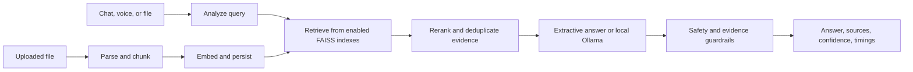

<div align="center">

# AURA
### Adaptive Universal RAG Assistant

**Your files in. Grounded answers out.**

An offline-first, multilingual chat assistant that lets you talk to your documents, inspect its sources, and see each step of the retrieval pipeline.


[Quick start](#-quick-start) · [How it works](#-how-it-works) · [Try the chat](#-chat-with-your-files) · [Run tests](#-test-and-benchmark)

</div>

---

## Meet AURA

AURA turns a collection of documents into a searchable, conversational workspace. Drop a file into a chat, ask a question in plain language, then check the retrieved passages and timing details behind the answer.

| Ask about your own files | See the evidence | Keep control |
| --- | --- | --- |
| Attach PDFs, Word docs, Markdown, text, CSV, JSON, and log files. | Inspect source excerpts, relevance scores, confidence, and stage timings. | Keep document retrieval scoped to its chat; choose whether to search the bundled corpus too. |

**Designed for:** local experiments, document Q&A, multilingual RAG demos, and fast iteration on a real retrieval pipeline.

> **Local-first, with clear boundaries:** Once the embedding model is cached, text and file-based RAG can run locally. First-time model setup may download model files. Voice transcription uses the optional Sarvam service and requires internet access. An optional Ollama model can draft longer answers on your own machine.

## What you can do

- **Chat with attachments:** Upload one or more supported files in the chat, or drag them into the window.
- **Search two knowledge sources:** Toggle chat files and the prebuilt AURA corpus independently.
- **Follow the pipeline:** Watch analyze, retrieve, rerank, generate, and guardrail stages with measured timings.
- **Check the answer:** Review retrieved excerpts, source names, scores, and grounded or abstained status.
- **Keep conversations organized:** Reopen saved chats; each chat's uploads are isolated from other chats.
- **Choose your answer style:** Use fast extractive answers by default, or optionally enable local Ollama drafting.
- **Try voice input:** Send a short recording through Sarvam Saaras v3 speech-to-text.

## How it works



### The six pipeline stages

1. **Listen** — accept a typed question, voice transcript, or attachment and associate it with a chat.
2. **Analyze** — infer language, query type, complexity, and normalized search text.
3. **Retrieve** — search the enabled base and chat-upload FAISS indexes.
4. **Rerank** — deduplicate candidates and blend semantic, lexical, and metadata relevance.
5. **Generate** — return a relevant evidence extract, or use a configured loopback Ollama model.
6. **Guardrail** — refuse unsafe or weakly supported requests rather than inventing an answer.

The FastAPI service hosts both the API and browser interface. The structured RAG controller also reports stage-level latency and grounding metadata, making the path easier to test and tune.

## Quick start

### Requirements

- Python 3.11 or newer
- The prebuilt files in `data/index/` (included in this repository)
- Internet access on first startup if the embedding model is not already cached

### Windows — one command

```powershell
.\run.ps1
```

The launcher creates `.venv` if needed, installs dependencies, creates `.env` from the example, and starts AURA at **http://127.0.0.1:8000**.

### Windows — manual setup

```powershell
python -m venv .venv
.\.venv\Scripts\python.exe -m pip install -r requirements.txt
Copy-Item .env.example .env
.\.venv\Scripts\python.exe -m uvicorn backend.main:app --host 127.0.0.1 --port 8000
```

### macOS / Linux

```bash
python3 -m venv .venv
.venv/bin/python -m pip install -r requirements.txt
cp .env.example .env
.venv/bin/python -m uvicorn backend.main:app --host 127.0.0.1 --port 8000
```

Open the chat at **http://127.0.0.1:8000**. The interactive API documentation is at **http://127.0.0.1:8000/docs** and the readiness check is at **http://127.0.0.1:8000/health**.

### Add voice or local generation (optional)

Add a Sarvam API key to `.env` to use voice transcription:

```dotenv
SARVAM_API_KEY=your_sarvam_api_key
```

For local answer drafting, install Ollama, pull a model, and set its name in `.env`:

```powershell
ollama pull qwen2.5:3b
```

```dotenv
AURA_LOCAL_LLM_URL=http://127.0.0.1:11434
AURA_LOCAL_LLM_MODEL=qwen2.5:3b
```

Leave `AURA_LOCAL_LLM_MODEL` blank to keep fast extractive answers. When enabled, AURA sends retrieved evidence only to the configured loopback Ollama server. It does not execute shell commands or write project files.

## Chat with your files

1. Choose **New chat** or reopen a conversation.
2. Select the paperclip or drop a supported document into the chat. Wait for the **indexed chunks** confirmation.
3. Ask a question about the file. Turn **Files** and **Corpus** on or off to control which indexes are searched.
4. Open **Details** to inspect the answer state, timing, analysis, and retrieved source excerpts.

**Supported formats:** PDF, TXT, Markdown, CSV, JSON, DOCX, and LOG. The default per-file size limit is **25 MB**; change it with `AURA_MAX_UPLOAD_MB`.

### Example API flow

Create a session, attach a file to it, and ask about that file:

```powershell
$session = Invoke-RestMethod -Method Post -Uri "http://127.0.0.1:8000/api/sessions"
$sessionId = $session.session_id

curl.exe -X POST `
  -F "file=@.\notes.pdf" `
  -F "session_id=$sessionId" `
  "http://127.0.0.1:8000/api/upload"

$body = @{
  message = "What are the main conclusions?"
  session_id = $sessionId
  use_base_corpus = $false
  use_uploads = $true
} | ConvertTo-Json

Invoke-RestMethod -Method Post `
  -Uri "http://127.0.0.1:8000/api/chat" `
  -ContentType "application/json" `
  -Body $body
```

The chat response includes the answer, grounding state, confidence, generation mode, source excerpts, analysis, per-stage timings, and attachment names. The legacy `POST /api/ask` endpoint remains available for one-off queries against the broader corpus.

## Test and benchmark

Run the workflow and guardrail tests:

```powershell
.\.venv\Scripts\python.exe -m unittest scripts.test_rag_workflow scripts.test_guardrails -v
```

Run the 100-query end-to-end RAG benchmark:

```powershell
.\.venv\Scripts\python.exe -m scripts.benchmark_e2e 100
```

The benchmark reports **P50, P70, and P100** for the full RAG path and its measured stages. The project target is a full RAG-path P100 below **200 ms**; actual timing depends on the machine and model. The report is written to `data/benchmark/e2e_benchmark_report.txt`.

## Configuration

| Variable | Default | What it controls |
| --- | --- | --- |
| `AURA_EMBEDDING_MODEL` | `paraphrase-multilingual-MiniLM-L12-v2` | Local multilingual embedding model |
| `AURA_MAX_UPLOAD_MB` | `25` | Maximum size of each uploaded file |
| `CORS_ORIGINS` | `*` | Comma-separated allowed browser origins |
| `SARVAM_API_KEY` | *(empty)* | Optional Sarvam voice transcription |
| `AURA_LOCAL_LLM_URL` | `http://127.0.0.1:11434` | Loopback Ollama server URL |
| `AURA_LOCAL_LLM_MODEL` | *(empty)* | Installed Ollama model; blank selects extractive answers |
| `AURA_LOCAL_LLM_TIMEOUT_SECONDS` | `90` | Local generation request timeout |

## Deploy with Docker

```powershell
docker build -t aura-rag .
docker run -p 8000:8000 --env-file .env aura-rag
```

Include `data/index/` in the deployment artifact. For a PaaS deployment, provide the optional environment variables through the platform configuration and use the included `Procfile`. First boot may download the sentence-transformer model; baking or caching it can improve cold-start time.

## Project map

```text
backend/
  main.py                 FastAPI routes, lifecycle, and UI hosting
  agent/chat_agent.py     Chat session orchestration
  rag/                    Parsing, chunking, retrieval, reranking, answers, guardrails
  services/sessions.py    Persistent chat sessions
frontend/
  index.html              Chat layout
  app.js                  Chat, uploads, voice, and live pipeline
  style.css               Responsive interface
data/
  index/                  Bundled FAISS index and metadata
scripts/
  test_rag_workflow.py    Upload, retrieval, and generation tests
  test_guardrails.py      Safety and grounding checks
  benchmark_e2e.py        Full RAG-path latency benchmark
```

Uploaded originals, saved sessions, the mutable user index, and `.env` are local runtime data and are excluded from Git.
